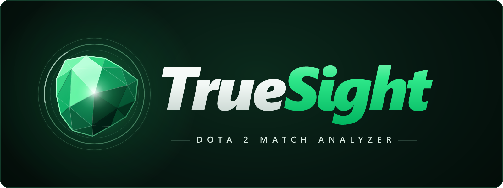
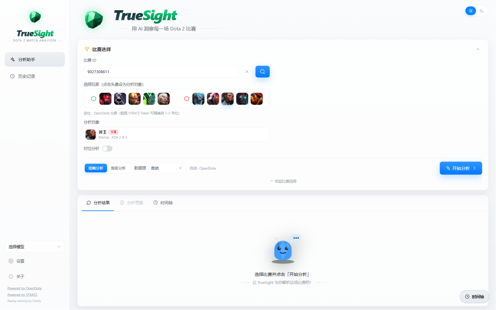
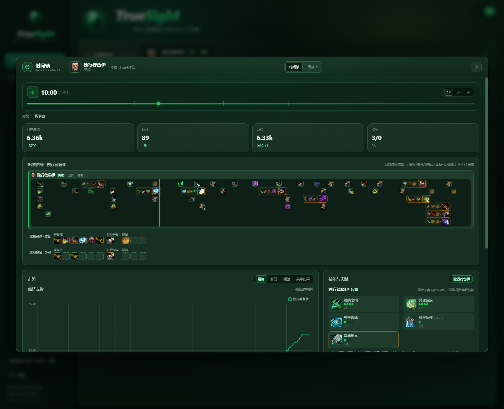
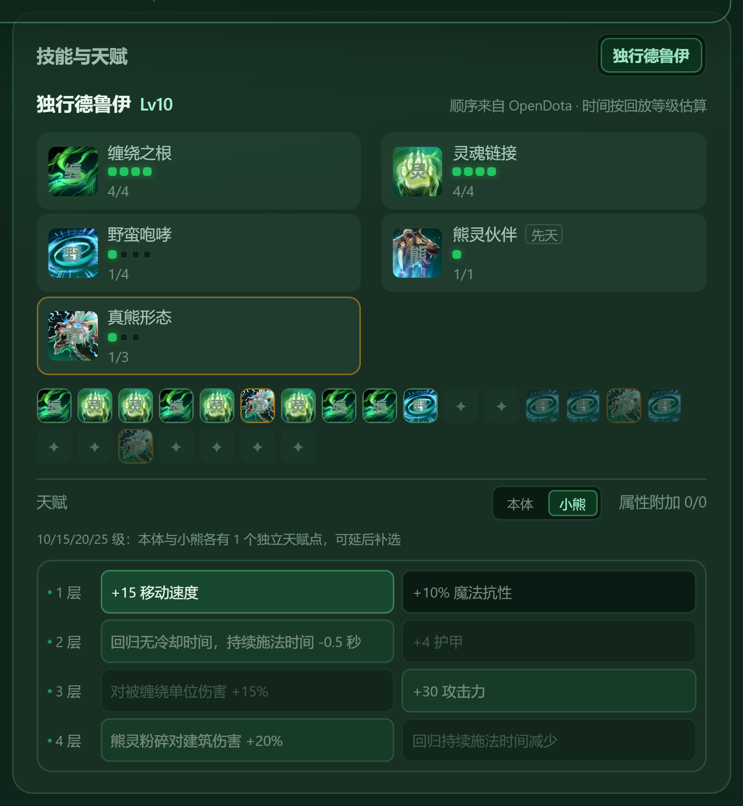
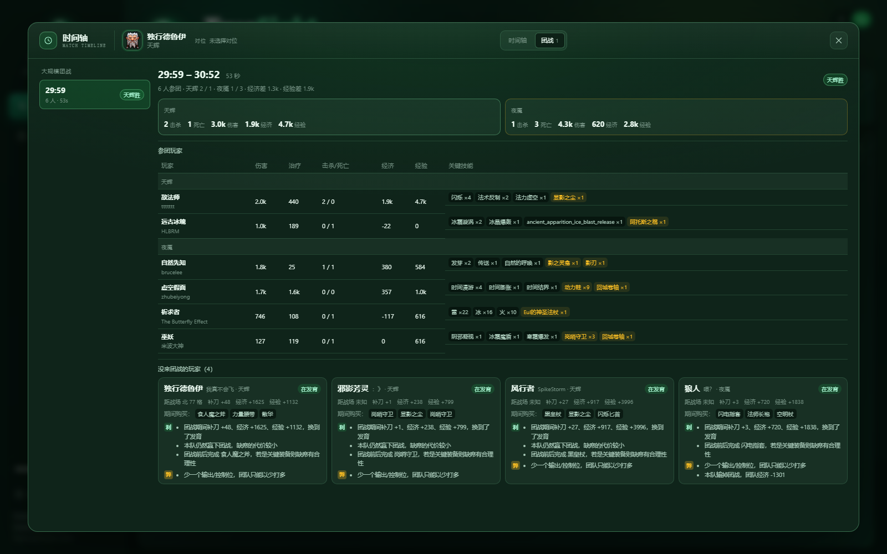
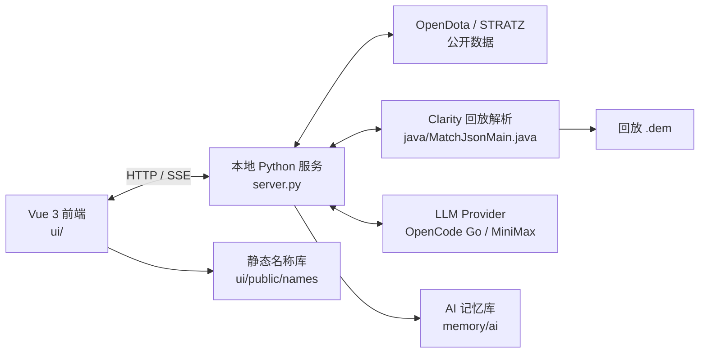

<p align="center">
  
</p>

<h1 align="center">TrueSight</h1>

<p align="center">
  <strong>DOTA 2 MATCH ANALYZER</strong><br />
  用 AI 洞察每一场 Dota 2 比赛
</p>

<p align="center">
  
  
  
  
  
  
</p>

---

TrueSight 是一个本地运行的 Dota 2 对局分析工具，将 **OpenDota / STRATZ 公开数据**、**本地 Clarity 回放解析** 与 **AI 复盘** 整合在同一套界面中。

它既能快速生成整场概览，也能展开逐分钟时间轴，查看出装路线、真实背包、技能加点、天赋选择、对位换血与团战参与情况。所有 API Key 只保存在浏览器本地，由本地服务转发请求，不进入前端静态资源或代码仓库。

<p align="center">
  
</p>

<p align="center"><em>主界面：比赛查询、选手选择、分析深度、数据源与对位入口</em></p>

## 目录

- [核心能力](#核心能力)
- [界面预览](#界面预览)
- [系统架构](#系统架构)
- [快速开始](#快速开始)
- [桌面客户端](#桌面客户端electron可选)
- [配置说明](#配置说明)
- [项目结构](#项目结构)
- [官网](#官网)
- [名称与图标数据](#名称与图标数据)
- [AI 记忆与多设备同步](#ai-记忆与多设备同步)
- [隐私与安全](#隐私与安全)
- [已知限制](#已知限制)
- [文档](#文档)

## 核心能力

### AI 对局分析

- 粗略分析：基于 OpenDota / STRATZ 的分钟级数据；
- 高级分析：本地 Clarity 解析录像，提供 5 秒级经济、技能、装备与战斗日志；
- 支持 OpenCode Go、MiniMax 等 OpenAI 兼容服务；
- 自动注入双方阵容、KDA、经济曲线、出装、技能与关键事件；
- 支持停止分析、保留已生成内容。

### AI 结果中的名称与图标

- 英雄、装备、消耗品、技能自动匹配中文官方名；
- 结果正文按 `[图标]名称` 渲染，阅读时可直接识别；
- 技能图标只显示图片，不在图标上叠加等级数字；
- 未知名称保留原文，不伪造数据。

### 时间轴与出装

- 5 秒级经济 / 补刀 / 经验 / 等级 / 英雄伤害曲线；
- 出装路线按真实购买、合成、卖出与消耗还原；
- 卷轴按 `mergedInto` 合并到成品，不再依赖购买时间窗口；
- 时间轴顶部展示完整对位阵容：边路 2v2 / 2v3（自定义）不再只显示敌方；
- 分析对象可从全部 10 名英雄中切换，并高亮标出；
- 分析对象下拉按天辉/夜魇分组，显示头像、名称、位置与选中勾选；
- 切换分析对象时，对位范围会按该英雄的分路自动调整；
- 「自动对位」开关与主界面「对位分析」勾选同步：勾选时切换对象自动按分路重建对位，取消时保留上次对位选择；
- 顶部「1v1 / 优势路 2v2 / 劣势路 2v2 / 自定义」可快速切换对位范围；
- 自定义对位支持最多 3 名我方（含分析对象）与 3 名敌方；
- 6 格装备栏 + 1 格打野装备 + 3 格背包实时快照；
- 小熊背包仅在分析德鲁伊本人时显示，其他英雄不会混入小熊数据；
- 真假眼拆分为独立记录，可堆叠消耗品按 FIFO 归属；
- 同一录像后台解析全部英雄，切换分析对象无需重新分析；
- 已有录像解析缓存时，选择英雄并处于高级分析会直接显示时间轴按钮，无需重新跑 AI。

### 对位与团战

- 对位 2v2 前 10 分钟：HP/MP、技能释放次数、补给、真假眼、击杀与死亡；
- 团战分析：伤害 / 治疗 / 增益 / 技能与物品行为；
- 即使没有造成英雄伤害，只要在战场附近提供治疗、护盾、增益或控制，也计入参团；
- 参团要求结合战场距离，全球伤害与全球治疗技能单独放行；
- 战场中心使用伤害玩家位置中位数，避免全屏技能玩家带偏。

### 德鲁伊双天赋树

- 本体 8 条天赋（4 层 × 2）；
- 小熊 8 条独立天赋（4 层 × 2）；
- 天赋区域可在「本体 / 小熊」之间切换；
- 两个天赋点独立，可延后补选。

### 主题与品牌

- TrueSight / 标准双主题；
- 深色 / 浅色模式；
- 统一的时间轴弹窗、结果卡片、设置页视觉规范；
- TrueSight 水晶 logo、favicon、PWA 图标。

## 界面预览

### 时间轴

<p align="center">
  
</p>

<p align="center"><em>经济曲线、出装路线、本体/小熊背包与技能加点</em></p>

### 技能与天赋

<p align="center">
  
</p>

<p align="center"><em>技能加点序列、本体/小熊双天赋树与可延后补选提示</em></p>

### 团战分析

<p align="center">
  
</p>

<p align="center"><em>参团玩家、伤害/治疗/经济/经验、关键技能，以及未参团玩家的位置与原因</em></p>

## 系统架构



- 浏览器只访问本地服务，不直接跨域请求第三方 API；
- 回放解析和 AI 请求都由 `server.py` 统一代理；
- 名称库优先生成静态 JSON，加载快、可离线缓存。

## 快速开始

### 环境要求

| 依赖 | 版本 | 用途 |
| --- | --- | --- |
| Windows | 10 / 11 | 当前主要运行环境 |
| Python | 3.10+ | 本地服务；仅标准库，无需 pip 依赖 |
| Node.js | 20+ | 前端开发与构建 |
| Java | 21 | 高级分析 / 回放解析 |
| Clarity | `lib/*.jar` + `classes/` | 回放解析运行时 |

> `runtime/`、`jre/`、`lib/`、`classes/`、`replays/`、`.cache/`、`ui/node_modules/`、`ui/dist/` 不进入 Git，需要在目标机器自行准备或重新构建。

### 一键准备运行环境（推荐）

```powershell
powershell -ExecutionPolicy Bypass -File tools\setup.ps1
```

脚本会自动完成：

1. 检查 Python 3.10+（项目只使用标准库，不需要 `pip install`）；
2. 检查 Java 21+ 与 `javac`；
3. 默认拉取 `../clarity` 最新代码并重新构建；
4. 把 Clarity 与依赖 jar 复制到 `lib/`；
5. 编译 `java/MatchJsonMain.java` 到 `classes/`；
6. 验证 Java 类路径与导出器可启动。

> Dota 录像协议会随游戏更新，因此 Clarity 不锁旧版本，setup 默认跟随最新代码。

可选参数：

```powershell
# 不自动克隆 Clarity
powershell -File tools\setup.ps1 -NoClone

# 只检查 Python / Java，跳过 Clarity
powershell -File tools\setup.ps1 -SkipClarity

# 保留当前 ../clarity，不拉取最新代码
powershell -File tools\setup.ps1 -NoUpdateClarity
```

### 构建与启动

```powershell
# 1. 安装并构建前端
cd ui
npm install
npm run build

# 2. 回到项目根目录启动（默认 8077，自动打开浏览器）
cd ..
.\start.bat
```

指定端口：

```powershell
.\start.bat 8080
```

### 开发模式

```powershell
# 终端 1：本地服务
.\start.bat

# 终端 2：Vite 开发服务器（5180，API 代理到 8077）
cd ui
npm run dev
```

### 桌面客户端（Electron，可选）

Web 模式保持不变。桌面模式共用同一套 `ui/`、`server.py`、Clarity 与运行时：

```powershell
# 首次准备环境并构建前端
powershell -ExecutionPolicy Bypass -File tools\setup.ps1
cd ui
npm install
npm run build
cd ..

# 启动桌面开发模式
cd desktop
npm install
npm run dev
```

打包 Portable 客户端：

```powershell
npm run dist
```

产物在 `desktop/release/`。桌面模式使用随机本地端口，数据写入 `%APPDATA%\TrueSight\data`，不会与 Web 模式的 8077 冲突。

详细说明见 [`desktop/README.md`](desktop/README.md)。

### 重新构建解析器

```powershell
javac --release 21 -encoding UTF-8 -cp "classes;lib/*" -d classes java\MatchJsonMain.java
```

## 配置说明

启动后打开左下角「设置」：

| 配置 | 说明 |
| --- | --- |
| AI 提供商 | OpenCode Go / MiniMax |
| API Key | 仅保存在浏览器 `localStorage` |
| Base URL | 默认使用提供商官方地址，可自定义 |
| 模型 | 由提供商模型列表或内置模型提供 |
| 推理强度 | low / medium / high / xhigh / max |
| STRATZ Token | 可选，用于精确位置与角色数据 |
| 数据源 | 自动 / 仅 OpenDota / 仅 STRATZ / 双源 |
| 主题 | TrueSight / 标准；深色 / 浅色 |

> API Key 不会写入仓库、日志或前端构建产物。

## 项目结构

```text
dota-chat/
├─ ui/                        Vue 前端
│  ├─ src/components/         时间轴、结果卡、比赛卡、设置、团战面板
│  ├─ src/lib/                数据模型、提示词、时间轴/团战/名称逻辑
│  ├─ scripts/build-names.mjs 名称库压缩
│  └─ public/                 品牌、favicon、静态名称库
├─ server.py                  本地 HTTP 服务 / API 代理 / 解析任务
├─ java/MatchJsonMain.java    Clarity 回放导出器
├─ data/names/                英雄、技能、天赋、装备源数据
├─ tools/names/               名称抓取、构建、审计
├─ tools/memory/              记忆快照与 Git hook 安装
├─ tools/setup.ps1            Python / Java / Clarity 一键准备
├─ memory/ai/                 AI 开发记忆
├─ website/                   官网静态站点
├─ desktop/                   Electron 桌面客户端
├─ docs/                      设计与功能文档、截图
├─ .githooks/                 提交 / 推送钩子
└─ start.bat                  Windows 启动脚本
```

## 名称与图标数据

- 英雄 / 技能 / 天赋 / 装备中文名：Dota 2 官方 datafeed + OpenDota 常量；
- 图标：Steam 官方 CDN（`cdn.cloudflare.steamstatic.com`）；
- 图纸统一使用官方 `recipe.png`；
- 缺失的官方图标按英雄头像或占位图回退；
- 新天赋若 datafeed/OpenDota 尚未收录，在 `tools/names/build.py` 的 `MANUAL_TALENTS` 中补充。

重新生成：

```powershell
cd ui
npm run names
```

刷新源数据：

```powershell
python tools/names/fetch_raw.py
python tools/names/build.py
```

## 官网

项目官网为纯静态站点，源码位于 [`website/`](website/README.md)，包含功能展示、界面预览、下载入口和图文使用说明。官网支持 **TrueSight / 标准** 双主题切换。

本地预览：

```powershell
python -m http.server 4173 --directory website
```

打开 `http://127.0.0.1:4173/`。

部署到 Cloudflare Workers：

```powershell
npx wrangler deploy
```

配置文件为 [`wrangler.jsonc`](wrangler.jsonc)，静态资源绑定 `website/`。

线上地址：<https://truesight.carloswhitea1e.workers.dev/>

## AI 记忆与多设备同步

仓库内保存了可持续同步的 AI 开发记忆：

| 文件 | 内容 |
| --- | --- |
| [memory/ai/context.md](memory/ai/context.md) | 架构、命令、运行约束 |
| [memory/ai/decisions.md](memory/ai/decisions.md) | 长期设计决策 |
| [memory/ai/changelog.md](memory/ai/changelog.md) | 近期变更 |
| [memory/ai/state.md](memory/ai/state.md) | 每次提交自动生成的快照 |

首次克隆后执行一次：

```powershell
powershell -ExecutionPolicy Bypass -File tools/memory/install.ps1
```

之后：

- `git commit` 前自动运行 `tools/memory/update.py`；
- 自动更新并暂存 `memory/ai/state.md`；
- `git push` 前检查当前 HEAD 是否包含记忆快照；
- 其他设备拉取后即可获得最新上下文。

## 隐私与安全

- 所有第三方请求由本地 `server.py` 转发；
- API Key / STRATZ Token 仅保存在浏览器 `localStorage`；
- `.env`、日志、缓存、录像、运行时与依赖目录均已加入 `.gitignore`；
- 仓库不包含任何 API Key、Token、账号密码或私钥；
- 提交前可使用 `git status` 与 `git diff --cached` 复核。

## 已知限制

- 高级分析依赖 Java 21 + Clarity jar，首次使用需要准备运行时；
- 守卫在战争迷雾中可能延迟出现，真假眼类型按插眼顺序校准；
- 全球技能白名单为手动维护，新版本技能需要补充；
- 基础模式没有回放坐标，无法进行团战距离判断；
- 部分新天赋 / 装备在 OpenDota、官方 datafeed 中可能滞后，需要人工补充；
- 当前主要面向 Windows 本地运行，其他平台需要自行调整启动脚本。

## 文档

- [时间轴弹窗](docs/timeline-dock.md)
- [时间轴图表](docs/timeline-chart.md)
- [装备与图标数据](docs/item-catalog.md)
- [背包模型](docs/item-inventory.md)
- [团战分析](docs/teamfights.md)
- [AI 记忆库](memory/ai/README.md)

---

<p align="center">
  <strong>TrueSight</strong><br />
  DOTA 2 MATCH ANALYZER
</p>
