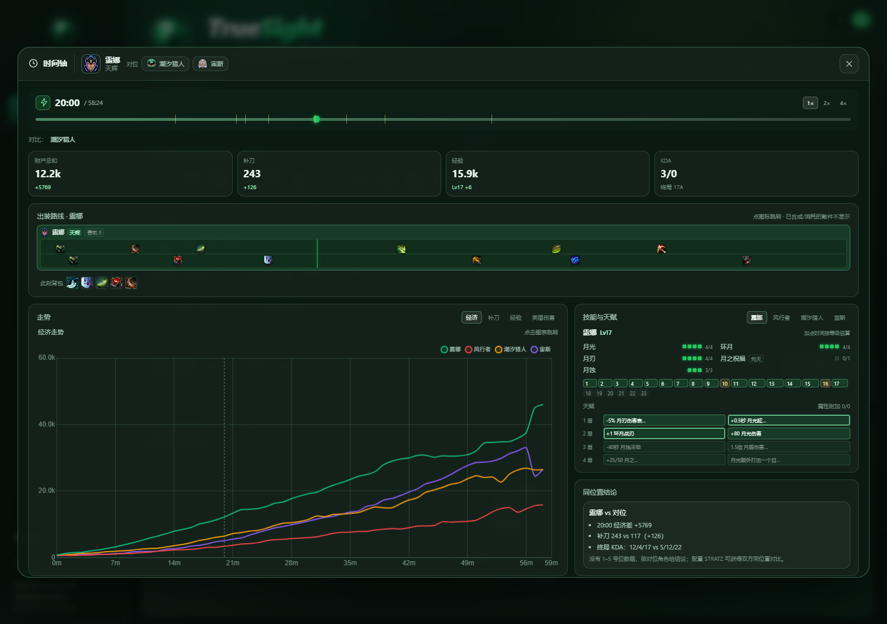
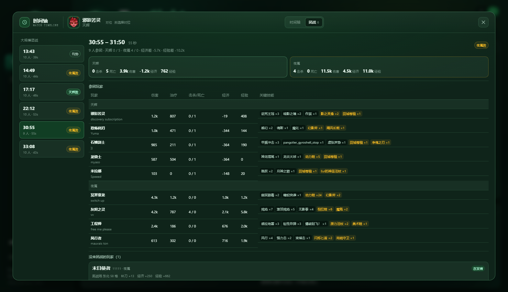

<p align="center">
  
</p>

<h1 align="center">TrueSight</h1>

<p align="center">
  <strong>用 AI 洞察每一场 Dota 2 比赛</strong><br />
  Dota 2 对局分析 · 回放时间轴 · 对位拆解 · 团战复盘
</p>

---

TrueSight 是一个本地运行的 Dota 2 对局分析工具。它把 OpenDota / STRATZ 的公开数据、本地 Clarity 回放解析和 AI 复盘整合到同一个界面里：既可以快速做整场概览，也可以展开时间轴逐分钟查看出装、技能、经济和对位细节。

## 功能

### AI 对局分析

- 支持粗略分析 / 高级分析（本地回放）；
- 支持 OpenCode Go、MiniMax 等 OpenAI 兼容提供商；
- 自动注入双方阵容、KDA、经济曲线、出装、技能与录像事件；
- 分析结果中的英雄、装备、技能自动匹配中文名与图标；
- 支持停止分析、保留已生成内容。

### 时间轴

- 5 秒级经济 / 补刀 / 经验 / 等级 / 伤害曲线；
- 出装路线：散件、卷轴、合成、卖出、消耗按真实格位还原；
- 6 格装备栏 + 打野装备 + 3 格背包的实时快照；
- 技能加点顺序、天赋树、属性附加；
- 德鲁伊本体 / 小熊双天赋树切换；
- 真假眼独立购买记录、按 FIFO 队列归属消耗；
- 对位 2v2 前 10 分钟：HP/MP、技能释放、补给、真假眼、击杀与死亡；
- 团战分析：伤害/治疗/技能/物品行为 + 战场距离 + 全球技能例外。

### 体验

- TrueSight / 标准双主题，深色 / 浅色模式；
- TrueSight 水晶品牌 logo、favicon、PWA 图标；
- 时间轴弹窗、结果卡片、设置页统一视觉规范；
- 中文名称库 + Steam 官方 CDN 图标。

## 截图

| 时间轴 | 团战分析 |
| --- | --- |
|  |  |

## 技术栈

| 层 | 技术 |
| --- | --- |
| 前端 | Vue 3.5 · TypeScript · Vite 8 · Chart.js 4 |
| 本地服务 | Python 3 标准库 HTTP Server |
| 回放解析 | Java 21 · [Clarity](https://github.com/skadistats/clarity) |
| 数据源 | OpenDota · STRATZ · Dota 2 官方 datafeed · Steam CDN |
| AI | OpenAI 兼容 `/chat/completions`（OpenCode Go / MiniMax） |

## 快速开始

### 环境

- Windows（当前主要开发环境）
- Python 3.10+
- Node.js 20+
- Java 21（仅高级分析 / 回放解析需要）
- Clarity 运行时 jar（放在 `lib/`）和编译好的 `classes/`

> `runtime/`、`jre/`、`lib/`、`classes/`、`replays/`、`.cache/` 不进入 Git，需要在目标机器自行准备或重新构建。

### 启动

```powershell
# 1. 安装前端依赖并构建
cd ui
npm install
npm run build

# 2. 回到项目根目录启动本地服务（默认 8077，自动打开浏览器）
cd ..
.\start.bat
```

也可以指定端口：

```powershell
.\start.bat 8080
```

开发模式（Vite 5180，API 代理到 8077）：

```powershell
# 终端 1
.\start.bat

# 终端 2
cd ui
npm run dev
```

### 配置

启动后打开左下角「设置」：

- 选择 AI 提供商（OpenCode Go / MiniMax）；
- 填写对应 API Key 与 Base URL；
- 可选填写 STRATZ Token（精确位置/角色数据）；
- 选择模型、推理强度、数据源和主题。

API Key 只保存在浏览器 `localStorage`，不会写入仓库或上传到本项目服务器。

## 项目结构

```text
dota-chat/
├─ ui/                     Vue 前端
│  ├─ src/components/      时间轴、结果卡、比赛卡、设置等
│  ├─ src/lib/             数据模型、提示词、回放/时间轴/团战逻辑
│  ├─ scripts/build-names.mjs
│  └─ public/              品牌、favicon、静态名称库
├─ server.py               本地 HTTP 服务 / API 代理 / 解析任务
├─ java/MatchJsonMain.java Clarity 回放导出器
├─ data/names/             英雄、技能、天赋、装备名称源数据
├─ memory/                 AI 开发记忆（memory/ai）
├─ tools/names/            名称抓取、构建、审计脚本
├─ tools/memory/           记忆快照与 Git hook 安装
├─ docs/                   设计与功能文档
└─ .githooks/              提交/推送钩子
```

## 常用命令

```powershell
# 前端
cd ui
npm run dev          # Vite 开发服务器
npm run build        # 类型检查 + 生产构建（ui/dist）
npm run names        # 生成 ui/public/names/*.json

# 名称源数据（需要网络）
python tools/names/fetch_raw.py
python tools/names/build.py

# Java 回放解析器（Java 21）
javac --release 21 -encoding UTF-8 -cp "classes;lib/*" -d classes java\MatchJsonMain.java
```

## AI 记忆与多设备同步

仓库内保存了 AI 开发记忆，便于在不同设备、不同 AI 会话之间同步上下文：

- [memory/ai/context.md](memory/ai/context.md)：架构、命令、运行约束；
- [memory/ai/decisions.md](memory/ai/decisions.md)：长期设计决策；
- [memory/ai/changelog.md](memory/ai/changelog.md)：近期变更；
- [memory/ai/state.md](memory/ai/state.md)：每次提交自动生成的快照。

首次克隆后执行一次：

```powershell
powershell -ExecutionPolicy Bypass -File tools/memory/install.ps1
```

之后每次 `git commit` 会自动更新并暂存 `memory/ai/state.md`，`git push` 会检查快照是否存在，保证记忆随提交同步。

## 数据与隐私

- OpenDota / STRATZ 数据通过本地 `server.py` 代理，浏览器不直接跨域；
- AI 请求也由本地服务转发，API Key 不进入前端静态资源；
- `.env`、日志、缓存、录像、运行时和依赖目录均已加入 `.gitignore`；
- 仓库中不包含任何 API Key、Token 或账号密码。

## 已知限制

- 回放解析依赖本地 Clarity jar 与 Java 21；
- 守卫在战争迷雾中可能延迟出现，真假眼类型按插眼顺序校准；
- 全球技能白名单为手动维护；
- 基础模式没有回放坐标，无法做团战距离判断；
- 部分新天赋 OpenDota / 官方 datafeed 尚未收录，需要人工补充。

## 文档

- [时间轴弹窗](docs/timeline-dock.md)
- [时间轴图表](docs/timeline-chart.md)
- [装备与图标数据](docs/item-catalog.md)
- [背包模型](docs/item-inventory.md)
- [团战分析](docs/teamfights.md)
- [AI 记忆库](memory/ai/README.md)

---

<p align="center">
  TrueSight · DOTA 2 MATCH ANALYZER
</p>
