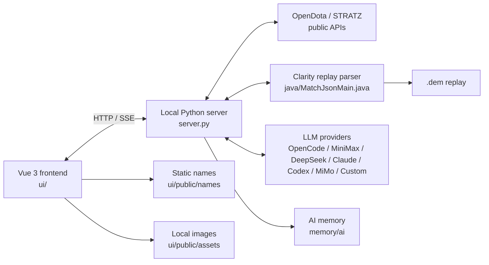

<p align="center">
  
</p>

<h1 align="center">TrueSight</h1>

<p align="center">
  <strong>Dota 2 Match Analyzer</strong><br />
  Local replay parsing, match timeline, combat nodes and AI-assisted review.
</p>

<p align="center">
  <a href="README.md">English</a> ·
  <a href="README.zh-CN.md">简体中文</a>
</p>

<p align="center">
  
  
  
  
  
  
  
  
</p>

---

**TrueSight** is a local-first Dota 2 match analysis app for Windows. It combines **OpenDota / STRATZ public data**, **local Clarity replay parsing**, and **LLM-assisted review** in a single interface.

Use it for a quick match overview or a minute-by-minute deep dive: item builds, real inventories, ability builds, talents, lane matchups, combat nodes, and AI coaching grounded in actual replay events. API keys stay in your browser's `localStorage`; replays and analysis data never leave your machine.

<p align="center">
  
</p>

<p align="center"><em>Main interface: match lookup, player selection, analysis depth, data sources, and matchup presets (Standard theme, light).</em></p>

## Table of Contents

- [Features](#features)
- [Screenshots](#screenshots)
- [Tech Stack](#tech-stack)
- [Architecture](#architecture)
- [Requirements](#requirements)
- [Getting Started](#getting-started)
- [Desktop Client](#desktop-client)
- [Configuration](#configuration)
- [Data and Assets](#data-and-assets)
- [Project Structure](#project-structure)
- [Website](#website)
- [Privacy and Security](#privacy-and-security)
- [Limitations](#limitations)
- [Documentation](#documentation)
- [Contributing](#contributing)
- [License](#license)
- [Acknowledgements](#acknowledgements)

## Features

### AI match review

- **Rough analysis** based on minute-level OpenDota / STRATZ data.
- **Advanced analysis** powered by a local Clarity replay parse with 5-second economy samples, ability casts, item purchases, and combat events.
- Supports **OpenCode Go, MiniMax, DeepSeek, OpenAI / Claude / Codex API, Xiaomi MiMo**, and any custom OpenAI-compatible or Anthropic-compatible endpoint.
- Injects both lineups, KDA, economy curves, item builds, abilities, and key events into the prompt.
- Streaming output with stop/resume; generated content is preserved when a request is cancelled.

### Match timeline and builds

- 5-second economy, last-hit, XP, level, and hero-damage curves.
- Item builds reconstructed from real purchases, combines, sells, and consumables.
- Recipes are merged into their finished items rather than inferred from purchase timing.
- Full matchup roster at the top: safe-lane and off-lane 2v2 / 2v3, not just the enemy side.
- Switch the analyzed player among all 10 heroes; the dropdown groups players by Radiant / Dire with portraits, names, positions, and selection state.
- Matchup presets follow the selected player's lane; the automatic-matchup switch stays in sync with the main form.
- Custom matchups support up to 3 allies (including the analyzed player) and 3 enemies.
- Real 6-slot inventory + neutral item slot + 3-slot backpack snapshots.
- Lone Druid's bear inventory is shown only when analyzing Lone Druid himself.
- Observer and Sentry wards are tracked separately; stackable consumables use FIFO attribution.
- All heroes in a replay are pre-parsed in the background, so switching players does not re-download or re-parse.
- When a replay cache exists, the timeline opens directly without another AI request.

### Combat nodes

- Focused on the analyzed player: kills, assists, and deaths are grouped into **solo kills, skirmishes, teamfights, and multi-kills**.
- Each node includes abilities, basic attacks, damage types, HP/MP, gold, XP, deaths, incoming damage, and its source.
- Heroes who cast a relevant ability, heal, shield, buff, or disable are counted as participants even if they dealt no hero damage.
- Participation uses battlefield distance; global damage and global healing abilities are whitelisted.
- The battlefield center uses the median position of damage dealers to avoid being dragged away by global casters.
- The combat timeline uses `MM:SS.mmm` precision (0.1 s in the underlying replay events).

### Lane matchups

- First-10-minute matchup data: HP/MP, ability casts, consumables, wards, kills, and deaths.
- Works for 1v1, safe-lane 2v2, off-lane 2v2, and custom 2–3 player pairs.

### Themes and desktop experience

- **TrueSight** (dark, green accent) and **Standard** (light, blue accent) themes; both support light and dark modes.
- The About page includes the version, changelog, open-source acknowledgements, security notes, and Valve asset attribution.
- Settings include a cache cleaner that removes replay parse JSON and temporary files while keeping replays, API keys, settings, and history.
- Crystal logo, favicon, and PWA icons.

### Local-first assets

- Hero portraits, hero icons, ability icons, and item icons are bundled in `ui/public/assets/`.
- The UI reads local files first and only falls back to the Steam CDN when a file is missing.
- Image assets are downloaded from Valve's official CDN and are copyrighted by Valve Corporation.

## Screenshots

### Timeline

<p align="center">
  
</p>

<p align="center"><em>Economy curves, item build path, real inventory, ability build, and talents (Standard theme, light).</em></p>

### Combat nodes

<p align="center">
  
</p>

<p align="center"><em>Participants, incoming damage sources, abilities and items, HP/MP, economy, and a 0.1-second combat timeline.</em></p>

## Tech Stack

| Layer | Technology |
| --- | --- |
| Frontend | Vue 3.5, TypeScript 5.9, Vite 8, Chart.js 4 |
| Local server | Python 3 standard library (HTTP + SSE) |
| Replay parser | Java 21 + Clarity 5.0.1, exported to schema 10 JSON |
| Desktop shell | Electron 44, electron-builder (NSIS + portable) |
| Website | Static HTML / CSS / JS, Cloudflare Workers + R2 |
| Public data | OpenDota, STRATZ, Valve Dota 2 datafeed |
| AI providers | OpenAI Chat Completions, OpenAI Responses, Anthropic Messages |

## Architecture



- The browser talks only to the local server; third-party APIs are proxied by `server.py`.
- Replay downloads, parsing, and AI requests are handled locally.
- The names index and image assets are static, so the UI works offline once a match has been loaded.

## Requirements

| Dependency | Version | Purpose |
| --- | --- | --- |
| Windows | 10 / 11 (x64) | Primary runtime |
| Python | 3.10+ | Local server; standard library only, no pip packages |
| Node.js | 20+ | Frontend development and build |
| Java | 21 | Advanced analysis / replay parsing |
| Clarity | `lib/*.jar` + `classes/` | Replay parser runtime |

> `runtime/`, `jre/`, `lib/`, `classes/`, `replays/`, `.cache/`, `ui/node_modules/`, and `ui/dist/` are intentionally not committed. Use the setup script or the desktop installer to prepare them.

## Getting Started

### 1. One-command setup (recommended)

```powershell
powershell -ExecutionPolicy Bypass -File tools\setup.ps1
```

The script:

1. Checks Python 3.10+ (no `pip install` needed).
2. Checks Java 21+ and `javac`.
3. Clones/updates `../clarity` and rebuilds it by default.
4. Copies Clarity and dependency JARs into `lib/`.
5. Compiles `java/MatchJsonMain.java` into `classes/`.
6. Verifies the Java classpath and exporter startup.

Optional flags:

```powershell
# Do not clone Clarity automatically
powershell -File tools\setup.ps1 -NoClone

# Only check Python / Java, skip Clarity
powershell -File tools\setup.ps1 -SkipClarity

# Keep the current ../clarity checkout
powershell -File tools\setup.ps1 -NoUpdateClarity
```

> Dota 2's replay protocol changes with game updates, so Clarity is intentionally not pinned to an old revision.

### 2. Build and run

```powershell
cd ui
npm install
npm run build
cd ..

.\start.bat          # defaults to http://127.0.0.1:8077
.\start.bat 8080     # custom port
```

### 3. Development mode

```powershell
# Terminal 1: local server
.\start.bat

# Terminal 2: Vite dev server (5180, API proxied to 8077)
cd ui
npm run dev
```

### 4. Rebuild the parser

```powershell
javac --release 21 -encoding UTF-8 -cp "classes;lib/*" -d classes java\MatchJsonMain.java
```

## Desktop Client

The web mode remains available. The desktop client reuses the same `ui/`, `server.py`, Clarity, and runtime, and bundles everything into a Windows app.

### Development

```powershell
powershell -ExecutionPolicy Bypass -File tools\setup.ps1
cd ui
npm install
npm run build
cd ..

cd desktop
npm install
npm run dev
```

### Packaging

```powershell
cd desktop
npm run dist            # Portable: TrueSight-Portable-0.1.0-x64.exe (~185 MB)
npm run dist:installer  # Setup:    TrueSight-Setup-0.1.0-x64.exe (~202 MB)
```

Artifacts are written to `desktop/release/`. The app bundles Python, Java 21, Clarity, and all hero / ability / item images. It uses a random loopback port and stores data in `%APPDATA%\TrueSight\data`, so it can run alongside the web mode on port 8077.

If packaged files end up with low mandatory integrity in a sandboxed environment, run:

```powershell
powershell -ExecutionPolicy Bypass -File tools\desktop\fix-integrity.ps1
```

See [`desktop/README.md`](desktop/README.md) for details.

## Configuration

Open **Settings** in the lower-left corner.

| Setting | Description |
| --- | --- |
| AI provider | OpenCode Go / MiniMax / DeepSeek / OpenAI / Claude / Codex API / Xiaomi MiMo / Custom |
| API key | Stored only in browser `localStorage` |
| Base URL | Provider default, editable; required for custom providers |
| Model | Loaded from the provider catalog or entered manually |
| Reasoning effort | low / medium / high / xhigh / max / ultra, or any custom value; DeepSeek and MiMo do not receive the field |
| STRATZ token | Optional; enables precise positions and roles |
| Data source | Auto / OpenDota only / STRATZ only / Both |
| Theme | TrueSight / Standard; light / dark |

### Custom providers

Custom providers support:

- `OpenAI Chat Completions`
- `OpenAI Responses`
- `Anthropic Messages`

You can set the provider ID, display name, API URL, protocol, API key, model ID, model catalog, and reasoning levels. When the catalog is empty, manually entered model IDs are still sent. When fetching a catalog, TrueSight reads `capabilities.reasoning.effort`, `reasoning.effort`, or `thinkingLevelMap` to populate levels such as `low / medium / high / xhigh / max / ultra`. Reasoning levels use a tag editor: click a preset, or type a value and press comma/Enter; click × to remove; leave it empty to omit `reasoning_effort`.

> Claude Code / Codex subscription login and API keys are different mechanisms. TrueSight supports API keys and custom protocol endpoints; it does not implement subscription OAuth or CLI login.

## Data and Assets

### Public data

- Match, player, and item data: OpenDota and STRATZ.
- Replay events: Clarity (`java/MatchJsonMain.java`, schema 10).
- Names: Valve Dota 2 datafeed + OpenDota constants.

### Local images

- Location: `ui/public/assets/` (hero portraits, hero icons, ability icons, item icons).
- Current snapshot: 2026-11-10, **1407 PNG files, ~43.7 MB**.
- `ui/public/assets/manifest.json` records the generation time, file count, and failures; the About page displays it.
- All recipes share `recipe.png`.
- A few innate abilities have no official CDN icon; the corresponding hero icon is used as a placeholder.
- Images are © Valve Corporation and are used only for local match analysis and display.

Regenerate names:

```powershell
cd ui
npm run names
```

Download or update images:

```powershell
runtime\python\python.exe -X utf8 tools\assets\fetch_images.py
runtime\python\python.exe -X utf8 tools\assets\fetch_images.py --force
runtime\python\python.exe -X utf8 tools\assets\fetch_images.py --only heroes
# Remove images no longer referenced by the names index
runtime\python\python.exe -X utf8 tools\assets\fetch_images.py --prune
```

Refresh source name data:

```powershell
python tools/names/fetch_raw.py
python tools/names/build.py
```

See [docs/images.md](docs/images.md) and [memory/dota-images.md](memory/dota-images.md) for the update workflow.

## Project Structure

```text
dota-chat/
├─ ui/                        Vue frontend
│  ├─ src/components/         timeline, result card, match card, settings, about, combat nodes
│  ├─ src/lib/                data models, prompts, timeline / combat nodes / names
│  ├─ src/lib/assets.ts       local image URLs and CDN fallback chain
│  ├─ scripts/build-names.mjs names index builder
│  └─ public/                 brand, favicon, names, local image assets
├─ server.py                  local HTTP server, API proxy, parse jobs, cache cleanup
├─ java/MatchJsonMain.java    Clarity replay exporter
├─ data/names/                hero / ability / talent / item source data
├─ tools/names/               name fetching, building, auditing
├─ tools/assets/              hero, ability, and item image fetcher
├─ tools/memory/              memory snapshot and Git hook installer
├─ tools/setup.ps1            one-command Python / Java / Clarity setup
├─ memory/ai/                 AI development memory
├─ memory/dota-images.md      image snapshot, copyright, update workflow
├─ website/                   static website (Apple-style, light/dark)
├─ desktop/                   Electron desktop client
├─ docs/                      design and feature documentation, screenshots
├─ .githooks/                 commit / push hooks
└─ start.bat                  Windows launcher
```

## Website

The website source lives in [`website/`](website/README.md) and follows an Apple product-page style: large typography, full-width UI screenshots, generous spacing, and light/dark themes.

- **Standard (light):** light page, blue accent, light hero gradient.
- **TrueSight (dark):** dark page, green accent, black hero.
- Interface screenshots use the client's Standard theme and switch automatically with the site theme.
- Sections: overview, timeline, combat nodes, AI review, privacy, download, specs, and FAQ.
- Downloads are served by Cloudflare R2 through the Worker's `DOWNLOADS` binding.

Preview locally:

```powershell
python -m http.server 4173 --directory website
```

Open `http://127.0.0.1:4173/`. `/downloads/*` returns 404 locally; the live site serves files from R2.

Deploy:

```powershell
npx wrangler deploy
```

Live site: <https://truesight.carloswhitea1e.workers.dev/>

## Privacy and Security

- All third-party requests are proxied by the local `server.py`.
- API keys and STRATZ tokens are stored only in browser `localStorage`.
- Replays, parse results, and analysis history stay on the local machine.
- `.env`, logs, caches, replays, runtimes, and dependency directories are git-ignored.
- The repository contains no API keys, tokens, passwords, or private keys.
- Image assets default to local files and only fall back to the official Valve CDN when a file is missing.

## Limitations

- Advanced analysis requires Java 21 and Clarity; the first run may take a few minutes.
- Wards placed in fog of war can appear with a delay; ward type is calibrated from placement order.
- The global ability whitelist is maintained manually and needs updates for new patches.
- Basic mode has no replay events; combat nodes rely on the legacy OpenDota teamfight fallback.
- Some new talents or items may lag behind in OpenDota or the official datafeed and need manual additions.
- The app currently targets Windows; other platforms require adapting the launcher and packaging.
- Website screenshots must be re-captured in both light and dark versions when the UI changes.

## Documentation

Most in-repository documentation is written in Chinese.

- [Timeline dock](docs/timeline-dock.md)
- [Timeline chart](docs/timeline-chart.md)
- [Items and icons](docs/item-catalog.md)
- [Local image assets](docs/images.md)
- [Inventory model](docs/item-inventory.md)
- [Teamfight analysis](docs/teamfights.md)
- [Combat node design](docs/combat-nodes.md)
- [Website and screenshot guidelines](website/README.md)
- [AI memory](memory/ai/README.md)

## Contributing

Issues and pull requests are welcome.

1. Open an issue for bugs or feature proposals; include the match ID, a screenshot, and the relevant log excerpt when possible.
2. Keep changes focused; avoid committing generated assets unless the change intentionally updates them.
3. Run the frontend checks before submitting:

```powershell
cd ui
npm run typecheck
npm run build
```

4. Include manual verification steps in the pull request description. There is currently no automated test suite.

## License

This project is currently **unlicensed (`UNLICENSED`)**. The source code is publicly visible for reference and issue tracking, but no permission is granted to copy, modify, or redistribute it without the author's prior consent.

Dota 2 and its in-game artwork, including hero portraits, ability icons, and item icons, are © Valve Corporation. TrueSight is not affiliated with or endorsed by Valve.

## Acknowledgements

[OpenDota](https://www.opendota.com/) · [STRATZ](https://stratz.com/) · [Clarity](https://github.com/skadistats/clarity) · [Vue.js](https://vuejs.org/) · [Vite](https://vite.dev/) · [Chart.js](https://www.chartjs.org/) · [Electron](https://www.electronjs.org/) · [TypeScript](https://www.typescriptlang.org/) · [fastutil](https://fastutil.di.unimi.it/) · [snappy-java](https://github.com/xerial/snappy-java)

---

<p align="center">
  <strong>TrueSight</strong><br />
  DOTA 2 MATCH ANALYZER
</p>
