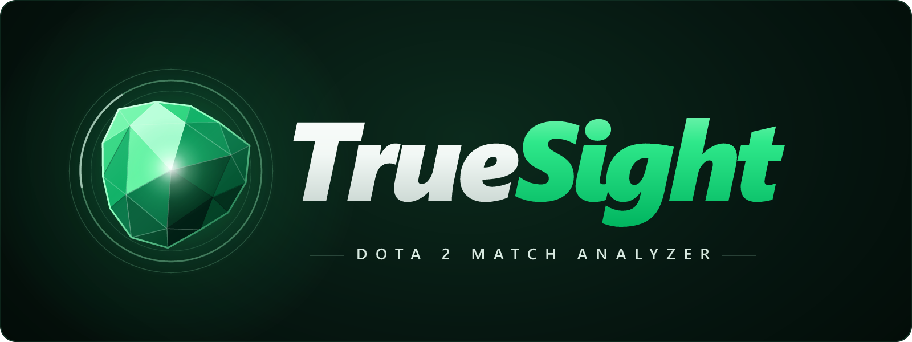
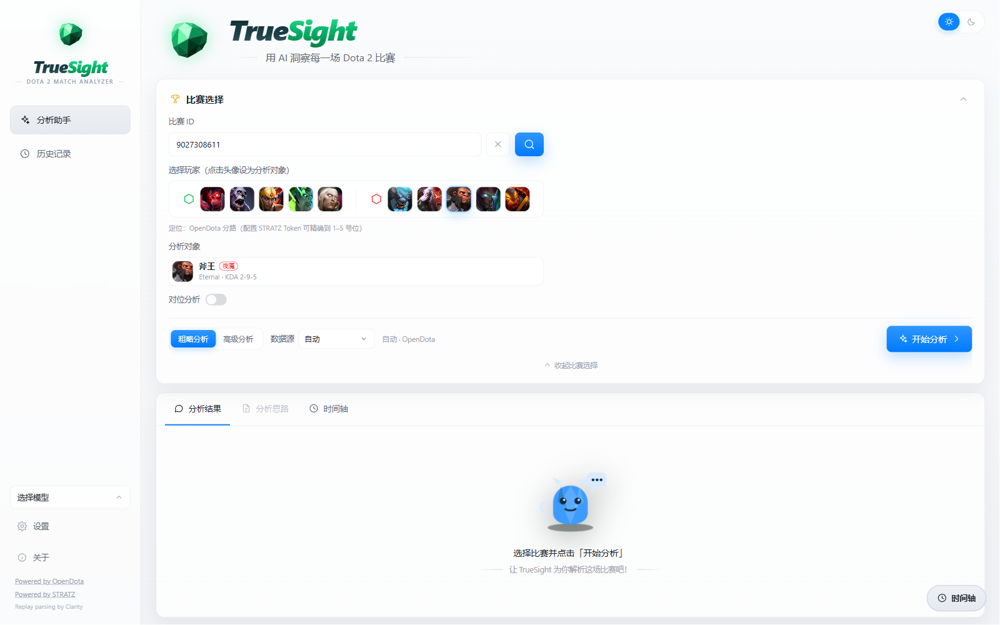
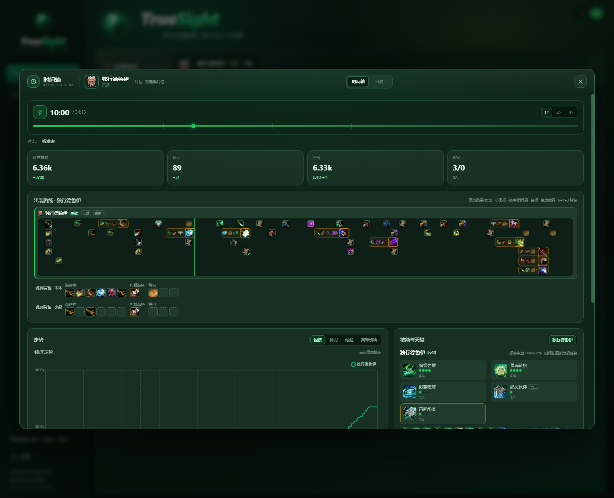
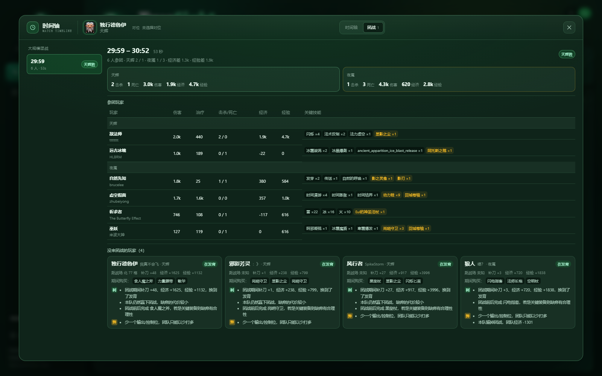
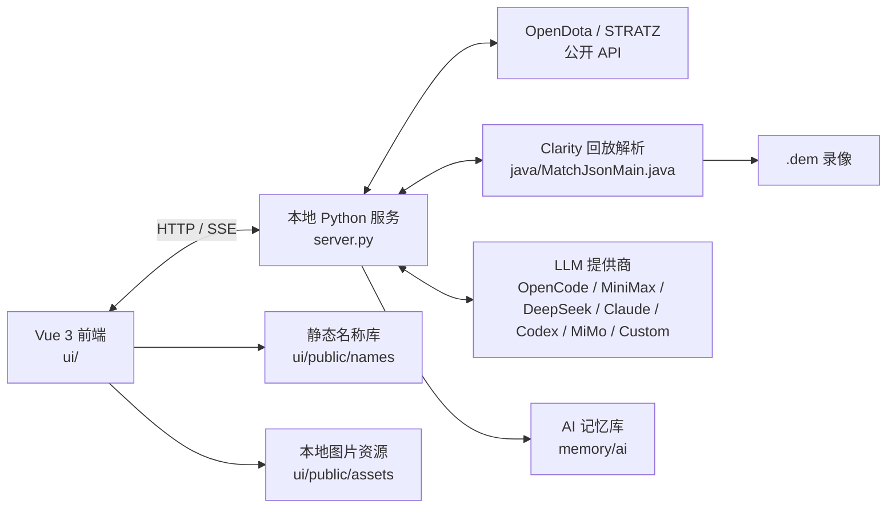

<p align="center">
  
</p>

<h1 align="center">TrueSight</h1>

<p align="center">
  <strong>Dota 2 对局分析工具</strong><br />
  本地回放解析、比赛时间轴、战斗节点与 AI 复盘。
</p>

<p align="center">
  <a href="README.md">English</a> ·
  <a href="README.zh-CN.md">简体中文</a>
</p>

<p align="center">
  
  
  
  
  
  
  
  
</p>

---

**TrueSight** 是一个面向 Windows 的本地优先 Dota 2 对局分析工具，将 **OpenDota / STRATZ 公开数据**、**本地 Clarity 回放解析** 与 **AI 复盘** 整合在同一套界面中。

它既能快速生成整场概览，也能展开逐分钟时间轴：出装路线、真实背包、技能加点、天赋选择、对位换血、战斗节点，以及引用录像事实的 AI 教练式复盘。API Key 只保存在浏览器 `localStorage`；回放与分析数据都留在本机，不经过云端。

<p align="center">
  
</p>

<p align="center"><em>主界面：比赛查询、选手选择、分析深度、数据源与对位入口（标准主题 · 浅色）。</em></p>

## 目录

- [核心能力](#核心能力)
- [界面预览](#界面预览)
- [技术栈](#技术栈)
- [系统架构](#系统架构)
- [环境要求](#环境要求)
- [快速开始](#快速开始)
- [桌面客户端](#桌面客户端)
- [配置说明](#配置说明)
- [数据与资源](#数据与资源)
- [项目结构](#项目结构)
- [官网](#官网)
- [隐私与安全](#隐私与安全)
- [已知限制](#已知限制)
- [文档](#文档)
- [贡献](#贡献)
- [许可证](#许可证)
- [致谢](#致谢)

## 核心能力

### AI 对局分析

- **粗略分析**：基于 OpenDota / STRATZ 的分钟级数据。
- **高级分析**：本地 Clarity 解析录像，提供 5 秒级经济、技能释放、装备购买与战斗事件。
- 支持 **OpenCode Go、MiniMax、DeepSeek、OpenAI / Claude / Codex API、小米 MiMo**，以及自定义 OpenAI 兼容或 Anthropic 兼容接口。
- 自动注入双方阵容、KDA、经济曲线、出装、技能与关键事件。
- 支持流式输出与停止分析；停止后已生成内容会保留。

### 时间轴与出装

- 5 秒级经济、补刀、经验、等级与英雄伤害曲线。
- 出装路线按真实购买、合成、卖出与消耗还原。
- 卷轴按 `mergedInto` 合并到成品，不再依赖购买时间窗口。
- 时间轴顶部展示完整对位阵容：边路 2v2 / 2v3，不再只显示敌方。
- 分析对象可从全部 10 名英雄中切换；下拉按天辉 / 夜魇分组，显示头像、名称、位置与选中状态。
- 对位范围会按分析对象的分路自动调整；「自动对位」与主界面「对位分析」保持同步。
- 自定义对位支持最多 3 名我方（含分析对象）与 3 名敌方。
- 6 格装备栏 + 1 格打野装备 + 3 格背包实时快照。
- 小熊背包仅在分析德鲁伊本人时显示，其他英雄不会混入小熊数据。
- 真假眼拆分为独立记录；可堆叠消耗品按 FIFO 归属。
- 同一录像后台解析全部英雄，切换分析对象无需重新解析。
- 已有录像解析缓存时，选择英雄并处于高级分析会直接显示时间轴按钮，无需重新跑 AI。

### 战斗节点

- 以分析对象为中心，将击杀、助攻与阵亡归并为**单杀、小规模、团战与多杀**节点。
- 每个节点包含技能、普攻、伤害类型、HP/MP、金钱、经验、阵亡、承伤来源与战斗时间线。
- 即使没有造成英雄伤害，只要技能、治疗、护盾、增益或控制参与了节点，也计入参战英雄。
- 参团判断结合战场距离；全球伤害与全球治疗技能单独放行。
- 战场中心使用伤害玩家位置中位数，避免被全屏技能玩家带偏。
- 战斗时间线使用 `MM:SS.mmm` 精度（底层回放事件精度 0.1 秒）。

### 对位分析

- 对位前 10 分钟：HP/MP、技能释放次数、补给、真假眼、击杀与死亡。
- 支持 1v1、优势路 2v2、劣势路 2v2 与自定义 2–3 人对位。

### 主题与桌面体验

- **TrueSight**（深色、绿色强调）与 **标准**（浅色、蓝色强调）双主题，均支持深色 / 浅色模式。
- 「关于」页包含版本号、更新日志、开源鸣谢、安全说明与 Valve 图片版权说明。
- 设置页可清理解析缓存与临时文件，保留录像、API Key、设置与历史记录。
- TrueSight 水晶 logo、favicon 与 PWA 图标。

### 本地资源

- 英雄头像、英雄小图标、技能图标与装备图标全部内置在 `ui/public/assets/`。
- 页面默认只读本地文件，缺失时才回退 Steam 官方 CDN。
- 图片来自 Valve 官方 CDN，版权归 Valve Corporation 所有。

## 界面预览

### 时间轴

<p align="center">
  
</p>

<p align="center"><em>经济曲线、出装路线、真实背包、技能加点与天赋选择（标准主题 · 浅色）。</em></p>

### 战斗节点

<p align="center">
  
</p>

<p align="center"><em>参团英雄、承伤来源、技能与装备、HP/MP、经济与 0.1 秒精度的战斗时间线。</em></p>

## 技术栈

| 层 | 技术 |
| --- | --- |
| 前端 | Vue 3.5、TypeScript 5.9、Vite 8、Chart.js 4 |
| 本地服务 | Python 3 标准库（HTTP + SSE） |
| 回放解析 | Java 21 + Clarity 5.0.1，导出 schema 10 JSON |
| 桌面壳 | Electron 44、electron-builder（NSIS + 便携版） |
| 官网 | 静态 HTML / CSS / JS、Cloudflare Workers + R2 |
| 公开数据 | OpenDota、STRATZ、Valve Dota 2 datafeed |
| AI 协议 | OpenAI Chat Completions、OpenAI Responses、Anthropic Messages |

## 系统架构



- 浏览器只访问本地服务，第三方 API 由 `server.py` 统一代理。
- 回放下载、解析与 AI 请求都在本机完成。
- 名称库与图片资源为静态文件，比赛数据加载后可离线查看。

## 环境要求

| 依赖 | 版本 | 用途 |
| --- | --- | --- |
| Windows | 10 / 11（x64） | 主要运行环境 |
| Python | 3.10+ | 本地服务；仅标准库，无需 pip 依赖 |
| Node.js | 20+ | 前端开发与构建 |
| Java | 21 | 高级分析 / 回放解析 |
| Clarity | `lib/*.jar` + `classes/` | 回放解析运行时 |

> `runtime/`、`jre/`、`lib/`、`classes/`、`replays/`、`.cache/`、`ui/node_modules/`、`ui/dist/` 不进入 Git，需要在目标机器通过安装包或 setup 脚本准备。

## 快速开始

### 1. 一键准备环境（推荐）

```powershell
powershell -ExecutionPolicy Bypass -File tools\setup.ps1
```

脚本会自动完成：

1. 检查 Python 3.10+（无需 `pip install`）。
2. 检查 Java 21+ 与 `javac`。
3. 默认拉取 / 更新 `../clarity` 并重新构建。
4. 把 Clarity 与依赖 jar 复制到 `lib/`。
5. 编译 `java/MatchJsonMain.java` 到 `classes/`。
6. 验证 Java 类路径与导出器可启动。

可选参数：

```powershell
# 不自动克隆 Clarity
powershell -File tools\setup.ps1 -NoClone

# 只检查 Python / Java，跳过 Clarity
powershell -File tools\setup.ps1 -SkipClarity

# 保留当前 ../clarity，不拉取最新代码
powershell -File tools\setup.ps1 -NoUpdateClarity
```

> Dota 录像协议会随游戏更新，因此 Clarity 不锁定旧版本。

### 2. 构建与启动

```powershell
cd ui
npm install
npm run build
cd ..

.\start.bat          # 默认 http://127.0.0.1:8077
.\start.bat 8080     # 自定义端口
```

### 3. 开发模式

```powershell
# 终端 1：本地服务
.\start.bat

# 终端 2：Vite 开发服务器（5180，API 代理到 8077）
cd ui
npm run dev
```

### 4. 重新构建解析器

```powershell
javac --release 21 -encoding UTF-8 -cp "classes;lib/*" -d classes java\MatchJsonMain.java
```

## 桌面客户端

Web 模式保持不变。桌面客户端复用同一套 `ui/`、`server.py`、Clarity 与运行时，并打包为 Windows 应用。

### 开发

```powershell
powershell -ExecutionPolicy Bypass -File tools\setup.ps1
cd ui
npm install
npm run build
cd ..

cd desktop
npm install
npm run dev
```

### 打包

```powershell
cd desktop
npm run dist            # 便携版：TrueSight-Portable-0.1.0-x64.exe（约 185 MB）
npm run dist:installer  # 安装版：TrueSight-Setup-0.1.0-x64.exe（约 202 MB）
```

产物在 `desktop/release/`，已内置 Python、Java 21、Clarity 与全部英雄 / 技能 / 装备图标。桌面模式使用随机本地端口，数据写入 `%APPDATA%\TrueSight\data`，不会与 Web 模式的 8077 冲突。

打包后如遇沙箱产物低完整性导致无法启动：

```powershell
powershell -ExecutionPolicy Bypass -File tools\desktop\fix-integrity.ps1
```

详细说明见 [`desktop/README.md`](desktop/README.md)。

## 配置说明

打开左下角「设置」。

| 配置 | 说明 |
| --- | --- |
| AI 提供商 | OpenCode Go / MiniMax / DeepSeek / OpenAI / Claude / Codex API / 小米 MiMo / 自定义 |
| API Key | 仅保存在浏览器 `localStorage` |
| Base URL | 提供商默认地址，可自定义；自定义提供商必填 |
| 模型 | 从提供商目录加载，或手动填写 |
| 推理强度 | low / medium / high / xhigh / max / ultra，也可自定义任意档位；DeepSeek、MiMo 不发送该字段 |
| STRATZ Token | 可选，用于精确位置与角色数据 |
| 数据源 | 自动 / 仅 OpenDota / 仅 STRATZ / 双源 |
| 主题 | TrueSight / 标准；深色 / 浅色 |

### 自定义提供商

支持三种协议：

- `OpenAI Chat Completions`
- `OpenAI Responses`
- `Anthropic Messages`

可填写 Provider ID、显示名称、API 地址、协议、API Key、模型 ID、模型目录与推理档位。目录为空时不显示模型，但手填的模型 ID 仍会直接发送。获取模型目录时会读取 `capabilities.reasoning.effort`、`reasoning.effort` 或 `thinkingLevelMap`，自动填充 `low / medium / high / xhigh / max / ultra` 等档位；推理档位使用标签编辑，点选预设或输入逗号/回车生成标签，点 × 移除，留空则不发送 `reasoning_effort`。

> Claude Code / Codex 的订阅登录与 API Key 是两套机制；当前支持 API Key 与自定义协议接口，不包含订阅 OAuth / CLI 登录。

## 数据与资源

### 公开数据

- 比赛、选手与装备数据：OpenDota、STRATZ。
- 回放事件：Clarity（`java/MatchJsonMain.java`，schema 10）。
- 名称：Valve Dota 2 datafeed + OpenDota 常量。

### 本地图片

- 位置：`ui/public/assets/`（英雄头像、英雄小图标、技能图标、装备图标）。
- 当前快照：2026-11-10，**1407 个 PNG，约 43.7 MB**。
- `ui/public/assets/manifest.json` 记录生成时间、文件数与失败列表；「关于」页会读取显示。
- 所有图纸共用 `recipe.png`。
- 少数先天技能官方 CDN 没有独立图标，使用对应英雄小图标占位。
- 图片版权归 Valve Corporation 所有，仅用于本机的对局分析展示。

重新生成名称表：

```powershell
cd ui
npm run names
```

下载 / 更新图片：

```powershell
runtime\python\python.exe -X utf8 tools\assets\fetch_images.py
runtime\python\python.exe -X utf8 tools\assets\fetch_images.py --force
runtime\python\python.exe -X utf8 tools\assets\fetch_images.py --only heroes
# 清理名称表不再引用的旧图
runtime\python\python.exe -X utf8 tools\assets\fetch_images.py --prune
```

刷新源数据：

```powershell
python tools/names/fetch_raw.py
python tools/names/build.py
```

更新流程见 [docs/images.md](docs/images.md) 与 [memory/dota-images.md](memory/dota-images.md)。

## 项目结构

```text
dota-chat/
├─ ui/                        Vue 前端
│  ├─ src/components/         时间轴、结果卡、比赛卡、设置、关于、战斗节点面板
│  ├─ src/lib/                数据模型、提示词、时间轴 / 战斗节点 / 名称逻辑
│  ├─ src/lib/assets.ts       本地图片 URL 与 CDN 回退链
│  ├─ scripts/build-names.mjs 名称库构建
│  └─ public/                 品牌、favicon、名称库、本地图片资源
├─ server.py                  本地 HTTP 服务、API 代理、解析任务、缓存清理
├─ java/MatchJsonMain.java    Clarity 回放导出器
├─ data/names/                英雄 / 技能 / 天赋 / 装备源数据
├─ tools/names/               名称抓取、构建、审计
├─ tools/assets/              英雄、技能与装备图标抓取
├─ tools/memory/              记忆快照与 Git hook 安装
├─ tools/setup.ps1            Python / Java / Clarity 一键准备
├─ memory/ai/                 AI 开发记忆
├─ memory/dota-images.md      图片快照、版权与更新流程
├─ website/                   官网静态站点（Apple 产品页风格，深浅双主题）
├─ desktop/                   Electron 桌面客户端
├─ docs/                      设计与功能文档、截图
├─ .githooks/                 提交 / 推送钩子
└─ start.bat                  Windows 启动脚本
```

## 官网

官网源码位于 [`website/`](website/README.md)，采用 Apple 产品页风格：大标题、全宽界面截图、克制的留白与深浅两套主题。

- **标准（浅色）**：浅色页面 + 蓝色强调色，Hero 为浅灰渐变。
- **TrueSight（深色）**：深色页面 + 绿色强调色，Hero 为黑色。
- 界面截图使用客户端标准主题，浅色 / 深色两套随站点主题自动切换。
- 页面包含概览、时间轴、战斗节点、AI 复盘、隐私、下载、技术规格与 FAQ。
- 安装包由 Cloudflare R2 的 `truesight-downloads` bucket 提供，Worker 通过 `DOWNLOADS` 绑定输出 `/downloads/*`。

本地预览：

```powershell
python -m http.server 4173 --directory website
```

打开 `http://127.0.0.1:4173/`。本地预览时 `/downloads/*` 会 404，线上由 R2 提供。

部署：

```powershell
npx wrangler deploy
```

线上地址：<https://truesight.carloswhitea1e.workers.dev/>

## 隐私与安全

- 所有第三方请求由本地 `server.py` 转发。
- API Key 与 STRATZ Token 仅保存在浏览器 `localStorage`。
- 回放、解析结果与分析历史都保存在本机。
- `.env`、日志、缓存、录像、运行时与依赖目录均已加入 `.gitignore`。
- 仓库不包含任何 API Key、Token、账号密码或私钥。
- 图片默认读取本地文件，只有资源缺失时才回退 Valve 官方 CDN。

## 已知限制

- 高级分析依赖 Java 21 + Clarity，首次分析可能需要几分钟。
- 战争迷雾中的守卫可能延迟出现；真假眼类型按插眼顺序校准。
- 全球技能白名单为手动维护，新版本技能需要补充。
- 基础模式没有回放事件；战斗节点会回退到旧版 OpenDota 团战数据。
- 部分新天赋 / 装备在 OpenDota 或官方 datafeed 中可能滞后，需要人工补充。
- 当前主要面向 Windows；其他平台需要自行调整启动与打包。
- 界面更新后，官网需要同步重拍浅色 / 深色两套截图。

## 文档

- [时间轴弹窗](docs/timeline-dock.md)
- [时间轴图表](docs/timeline-chart.md)
- [装备与图标数据](docs/item-catalog.md)
- [图片资源本地化](docs/images.md)
- [背包模型](docs/item-inventory.md)
- [团战分析](docs/teamfights.md)
- [战斗节点设计](docs/combat-nodes.md)
- [官网维护与截图规范](website/README.md)
- [AI 记忆库](memory/ai/README.md)

## 贡献

欢迎提交 Issue 与 Pull Request。

1. Bug 或功能建议请先开 Issue，并尽量附上比赛 ID、截图与相关日志。
2. 保持改动聚焦；除非本次改动就是更新资源，否则不要提交生成的资源文件。
3. 提交前运行前端检查：

```powershell
cd ui
npm run typecheck
npm run build
```

4. 在 PR 描述中写明手动验证步骤。目前还没有自动化测试套件。

## 许可证

本项目当前为 **未授权（`UNLICENSED`）**。源码公开可见，供参考与问题反馈使用；未经作者事先同意，不授予复制、修改或再分发权利。

Dota 2 及游戏内美术资源（英雄头像、技能图标、装备图标等）版权归 Valve Corporation 所有。TrueSight 与 Valve 没有隶属或合作关系。

## 致谢

[OpenDota](https://www.opendota.com/) · [STRATZ](https://stratz.com/) · [Clarity](https://github.com/skadistats/clarity) · [Vue.js](https://vuejs.org/) · [Vite](https://vite.dev/) · [Chart.js](https://www.chartjs.org/) · [Electron](https://www.electronjs.org/) · [TypeScript](https://www.typescriptlang.org/) · [fastutil](https://fastutil.di.unimi.it/) · [snappy-java](https://github.com/xerial/snappy-java)

---

<p align="center">
  <strong>TrueSight</strong><br />
  DOTA 2 MATCH ANALYZER
</p>
