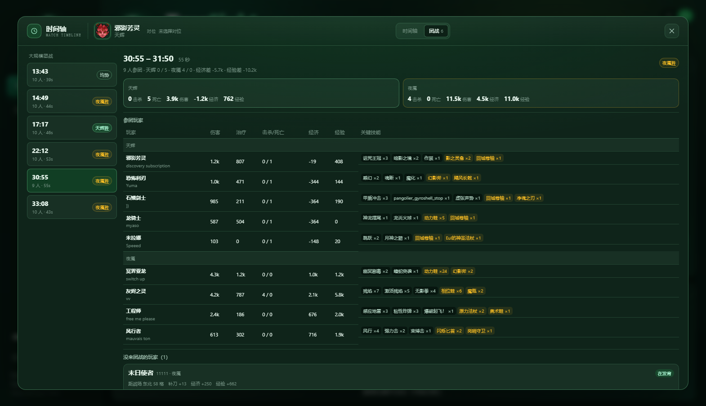
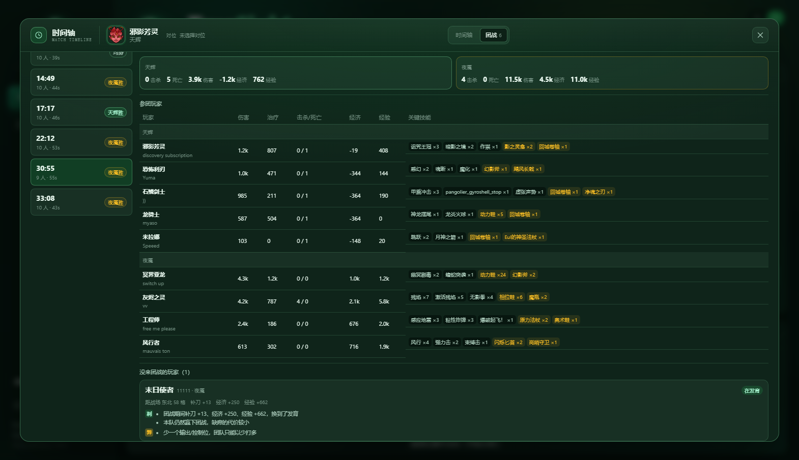

# 大规模团战复盘（6 人及以上）

入口：高级分析打开「时间轴」弹窗 → 顶部 **团战** 标签页。

## 数据来源

- **OpenDota `teamfights`**：每场团战的起止时间、每人伤害、治疗、击杀、死亡、买活、经济差、经验差、技能使用、物品使用、死亡位置；
- **回放坐标**（`MatchJsonMain`）：每 5 秒记录 10 个英雄的 `CBodyComponent.m_cellX/Y`、HP、队伍，输出 `positions.samples`；
- 英雄/技能/物品中文名来自本地名称表。

## 筛选规则

- 只保留 `start >= 0`、时长 ≥ 3 秒的团战；
- 参团判定：伤害 > 0、治疗 > 0、有死亡、有技能使用、有物品使用、或拿到英雄击杀；
- **参团人数 ≥ 6** 才进入列表（含 6 人）。

## 页面内容

### 团战列表

时间、参团人数、持续秒数、结果（天辉胜 / 夜魇胜 / 均势）。

### 整体收益 / 损失

- 双方击杀、死亡、总伤害、总治疗、经济差、经验差；
- 头部显示本场团战的经济差、经验差；
- 结果按击杀差判定，击杀相同再看经济差（±400 内算均势）。

### 参团玩家

每人一行：英雄、玩家名、伤害、治疗、击杀/死亡、经济、经验、关键技能与物品（次数）。

### 没来团战的玩家

每人一张卡片：

- **状态**：阵亡中 / 迟到 / 在附近 / 在发育 / 远离战场；
- **位置**：距战场中心多少格 + 方向（东北/西南等，来自回放坐标）；
- **期间收益**：补刀、经济、经验增量；
- **期间购买**：团战前后 30–120 秒内完成的装备；
- **利 / 弊**：
  - 利：换到发育、完成关键装、本队仍然赢团；
  - 弊：少一个输出/控制位、迟到、在附近却没参团、输团且没有发育收益。

状态判定：

| 状态 | 依据 |
| --- | --- |
| 阵亡中 | 团战开始时该玩家 HP = 0 |
| 迟到 | 团战结束前才进入战场中心 18 格内 |
| 在附近 | 开局距战场 ≤ 20 格，但没有战斗数据 |
| 在发育 | 期间补刀 ≥ 4 或经济 ≥ 120 |
| 远离战场 | 其余情况 |

## 已验证

- 9074689290（独行德鲁伊）：4 场 10 人团战，参团表、双方收益正常；
- 9075218521（邪影芳灵）：30:55 团战 9 人参团，末日使者缺席——距战场东北 58 格，期间补刀 +13、经济 +250、经验 +662，本队 4v5 仍以 4:0 赢团；利弊分别列出；
- 回放坐标约 4300 条（34 分钟、10 人、5 秒采样）。

## 边界

- 团战切分来自 OpenDota，和游戏内“团战”定义可能略有差异；
- 位置只有距离/方向，没有做“具体哪片野区/哪条线”的强行推断；
- 缺席原因是从位置、补刀、经济、购买推断的，不包含视野、语音、指挥信息；
- 需要回放解析（高级分析）才有位置数据；仅有 OpenDota 时缺席卡片会缺少距离/方向。
